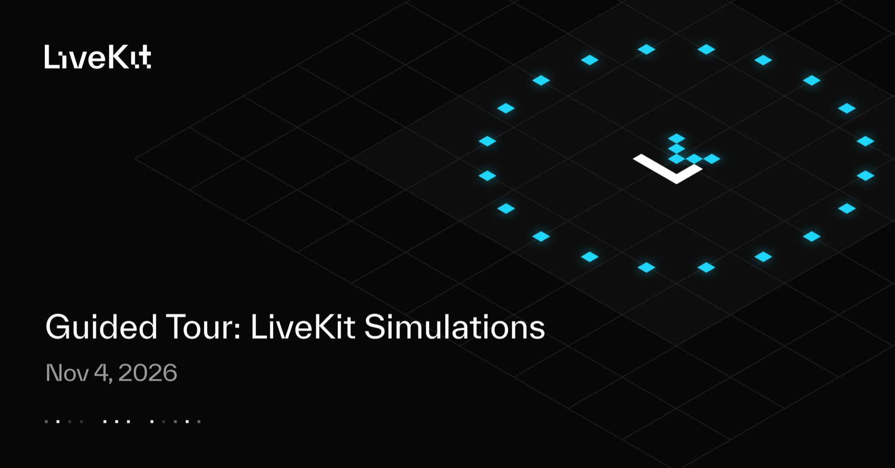

<a href="https://livekit.com/events/guided-tour-simulations">
  
</a>

# Guided Tour: LiveKit Simulations

Welcome to the Agent Simulations guided tour! This repository contains Front Desk, the voice agent from the tour, along with the scenarios and CI setup used to test it with [LiveKit Agent Simulations](https://docs.livekit.io/testing/simulations/).

Front Desk books office visits. It checks a calendar, offers open times, collects the caller's email, and books the appointment. You can call it at **+1 (415) 417-6472**.

## Prerequisites

To run this agent, you need the following:

- A [LiveKit Cloud](https://cloud.livekit.io) project
- The [LiveKit CLI](https://docs.livekit.io/intro/basics/cli/), version 2.19 or later
- A Python environment with [uv](https://docs.astral.sh/uv/) installed

The agent uses [LiveKit Inference](https://docs.livekit.io/agents/models/inference/) for all its models, so no other API keys are required.

## Setup

Step 1: Clone this repository

Step 2: Install dependencies

```shell
uv sync
```

Step 3: Sign in to LiveKit Cloud and load your project's keys into `.env.local`

```shell
lk cloud auth
lk app env --write --destination .env.local
```

Step 4: Talk to the agent in your terminal

```shell
lk agent console
```

## Running simulations

Run the scenarios in `scenarios.yaml` against your agent:

```shell
lk agent simulate text --scenarios scenarios.yaml
```

The CLI starts the agent locally, runs each scenario on LiveKit Cloud, and prints the result with a link to the run in the dashboard. Simulations run against your CLI's default project, which you can change with `lk project set-default`.

To generate new scenarios from the agent's source code instead:

```shell
lk agent simulate text --num-simulations 10
```

To run the same scenarios through the full speech pipeline:

```shell
lk agent simulate audio --scenarios scenarios.yaml
```

## How the scenarios work

Each scenario in `scenarios.yaml` describes a simulated caller (`instructions`), what the agent should do (`agent_expectations`), and optional `userdata`. Front Desk uses `userdata` to seed its calendar with `available_slots` and to check that the call ended with the `expected_booking`.

The simulation-specific code lives in `src/simulation.py`. The agent switches to it when `ctx.simulation_context()` is set, so the rest of the agent runs the same code in simulations as it does in production.

## Turning a session into a test

To make a scenario from a real call, open the session in the LiveKit Cloud dashboard, click **Turn into a test**, and download the scenario file. Then run it:

```shell
lk agent simulate text --scenarios ~/Downloads/scenarios.yaml
```

## CI

The workflows in `.github/workflows` run the text simulations on every pull request and the audio simulations nightly. To use them, add `LIVEKIT_URL`, `LIVEKIT_API_KEY`, and `LIVEKIT_API_SECRET` as repository secrets.

## Learn more

See the [Agent Simulations documentation](https://docs.livekit.io/testing/simulations/).
