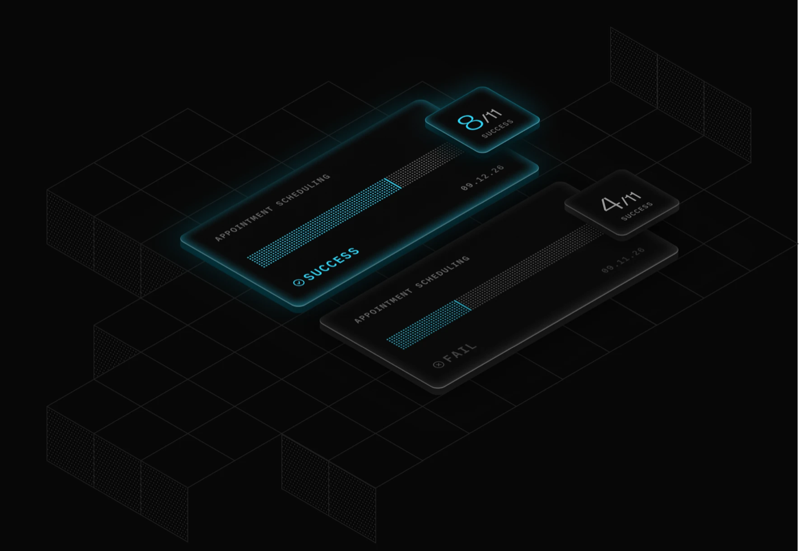
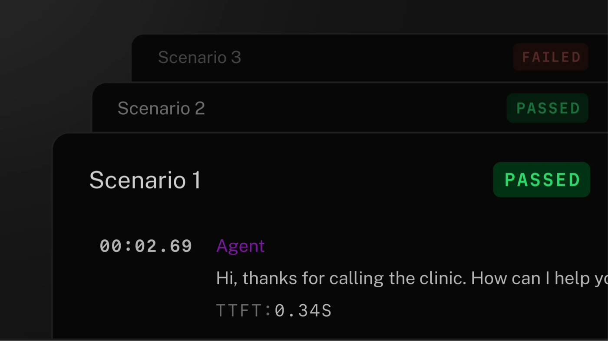
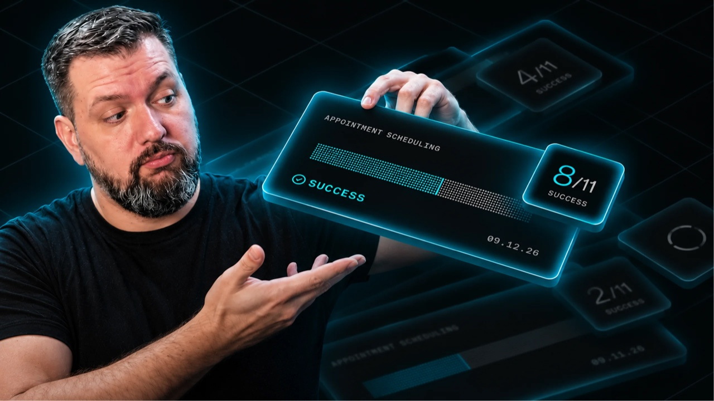

<a href="https://livekit.com/events/guided-tour-simulations">
  
</a>

<p align="center">
  <a href="https://livekit.com/events/guided-tour-simulations"><b>Event page</b></a> ·
  <a href="https://youtu.be/ycSxhQTKX7Y"><b>Walkthrough video</b></a> ·
  <a href="https://docs.livekit.io/testing/simulations/"><b>Simulations docs</b></a> ·
  <a href="https://livekit.com/products/agent-simulations"><b>Agent Simulations</b></a>
</p>

# Front Desk: Agent Simulations guided tour

The example project from the LiveKit Agent Simulations guided tour.

Front Desk is a voice agent built with [LiveKit Agents](https://github.com/livekit/agents) that books office visits. It checks a calendar, offers open times, collects the caller's email, and books the appointment. The project includes the scenarios used to test it with [Agent Simulations](https://docs.livekit.io/testing/simulations/) and a CI setup that runs them.

<p align="center">
  
</p>

## Project structure

| Path | Description |
| --- | --- |
| [`src/agent.py`](src/agent.py) | The agent: instructions, tools, and session setup |
| [`src/calendar_api.py`](src/calendar_api.py) | Calendar backends: in-memory, or [cal.com](https://cal.com) if `CAL_API_KEY` is set |
| [`src/simulation.py`](src/simulation.py) | Simulation support: seeds the calendar from a scenario and mocks the tools |
| [`scenarios.yaml`](scenarios.yaml) | Simulation scenarios |
| [`phone.yaml`](phone.yaml) | Scenarios for phone simulations |
| [`tests/`](tests/) | Unit tests |
| [`.github/workflows/`](.github/workflows/) | CI: text simulations, audio simulations, and lint |

## Setup

Requirements:

- [LiveKit CLI](https://docs.livekit.io/intro/basics/cli/) v2.19 or later (v2.19.3 or later for phone simulations)
- [uv](https://docs.astral.sh/uv/)
- A [LiveKit Cloud](https://cloud.livekit.io/) project

Install dependencies and write your project credentials to `.env.local`:

```console
uv sync
lk cloud auth
lk app env --write --destination .env.local
```

All models run on [LiveKit Inference](https://docs.livekit.io/agents/models/inference/), so no other API keys are required.

> [!NOTE]
> `lk agent simulate` uses the CLI's default project. Run `lk project list` to check it and `lk project set-default <name>` to change it.

## Run the agent

```console
lk agent console    # talk to it in your terminal
lk agent dev        # connect it to LiveKit Cloud
```

## Run simulations

```console
lk agent simulate text --scenarios scenarios.yaml
```

The CLI starts the agent locally, runs each scenario on LiveKit Cloud, and prints a result for each with a link to the run in the dashboard.

<p align="center">
  
</p>

To generate scenarios from the agent's source instead of using `scenarios.yaml`:

```console
lk agent simulate text -n 10
```

This uploads your source code to LiveKit Cloud. Press `s` when the run finishes to save the scenarios to a file.

### Audio simulations

Audio mode runs the full speech pipeline and measures latency, turn-taking, interruption handling, and transcription accuracy.

```console
lk agent simulate audio --scenarios scenarios.yaml
```

Add `--background-noise`, `--packet-loss`, or `--low-quality-microphone` to degrade the caller's audio.

### Phone simulations

A phone simulation calls a phone number and runs the scenario against whatever agent answers:

```console
lk agent simulate audio --scenarios phone.yaml --to <agent-number> --from <caller-id> --trunk <trunk-id>
```

This requires a [deployed agent](#deploy) with a phone number, and an outbound SIP trunk.

## How scenarios work

Each scenario defines a simulated caller, the expected outcome, and optional data for the agent:

```yaml
- label: Requested time unavailable, accepts an alternative
  instructions: |-
    You are Priya Nair, a nurse coming off a night shift...
    - Ask for an appointment on Monday, June 15 in the morning, around 9 AM.
    - When told mornings are not available, push back once...
  agent_expectations: The agent must clearly say the requested morning time is
    not available, without inventing a slot...
  userdata:
    available_slots:
      - "2026-06-15T14:00:00"
      - "2026-06-15T16:30:00"
    expected_booking: "2026-06-15T14:00:00"
```

| Field | Purpose |
| --- | --- |
| `instructions` | Who the simulated caller is and what they do |
| `agent_expectations` | What the judge checks in the transcript |
| `userdata.available_slots` | The open times on the agent's calendar for this run |
| `userdata.expected_booking` | The one booking that must exist at the end, or `null` for none |

When the agent detects a simulation, it replaces the calendar and tools with simulated ones:

```python
if sim := ctx.simulation_context():
    cal = simulation.fake_calendar(sim, timezone=TIMEZONE)
    tool_mocks = simulation.tool_mocks(cal, ZoneInfo(TIMEZONE))
```

- `fake_calendar` builds a calendar from `available_slots`, with the clock fixed at `2026-06-12T09:00`. Scenarios without `available_slots` get a default two-week calendar.
- `tool_mocks` replaces tool execution. The LLM still sees the real tool definitions.
- `on_simulation_end` in [`src/agent.py`](src/agent.py) fails the run if the final bookings don't match `expected_booking`.

## Turn a session into a test

To create a scenario from a real call, open the session in the LiveKit Cloud dashboard and click **Turn into a test**. Download the scenario file and run it:

```console
lk agent simulate text --scenarios ~/Downloads/scenarios.yaml
```

Add `available_slots` and `expected_booking` to check the final calendar state, then add the scenario to `scenarios.yaml`.

## CI

| Workflow | Trigger | Command |
| --- | --- | --- |
| [`simulations.yml`](.github/workflows/simulations.yml) | Pull requests and pushes to `main` | `lk agent simulate text --scenarios scenarios.yaml --samples 3 --concurrency 5` |
| [`simulations-audio.yml`](.github/workflows/simulations-audio.yml) | Daily at 06:00 UTC | `lk agent simulate audio --scenarios scenarios.yaml --concurrency 5` |
| [`ruff.yml`](.github/workflows/ruff.yml) | Pull requests and pushes to `main` | `ruff check` and `ruff format --check` |

`--samples 3` runs each scenario three times. A scenario passes if at least two runs pass.

The workflows need the `LIVEKIT_URL`, `LIVEKIT_API_KEY`, and `LIVEKIT_API_SECRET` repository secrets.

To view past runs:

```console
lk agent simulate list
lk agent simulate view <run-id>
```

## Unit tests

```console
uv run pytest
```

## Deploy

```console
lk agent create
```

The agent registers as `front-desk`. To receive phone calls, [set up an inbound trunk and a dispatch rule](https://docs.livekit.io/telephony/) for `front-desk`.

## Differences from the upstream example

This project is based on [`examples/frontdesk`](https://github.com/livekit/agents/tree/main/examples/frontdesk) in `livekit/agents`, with these changes:

- Rebooking during a call moves the existing appointment instead of creating a second one.
- The LiveKit turn detector and noise cancellation are enabled.
- The agent uses explicit dispatch with the name `front-desk`.
- The LiveKit Playground UI is removed.

## Resources

<a href="https://youtu.be/ycSxhQTKX7Y">
  
</a>

- [Agent Simulations](https://docs.livekit.io/testing/simulations/)
- [Run simulations in CI](https://docs.livekit.io/testing/simulations/ci/)
- [Agent Observability](https://docs.livekit.io/testing/observability/)
- [Agent debugger](https://docs.livekit.io/testing/debugger/)

## License

MIT. See [LICENSE](LICENSE).
